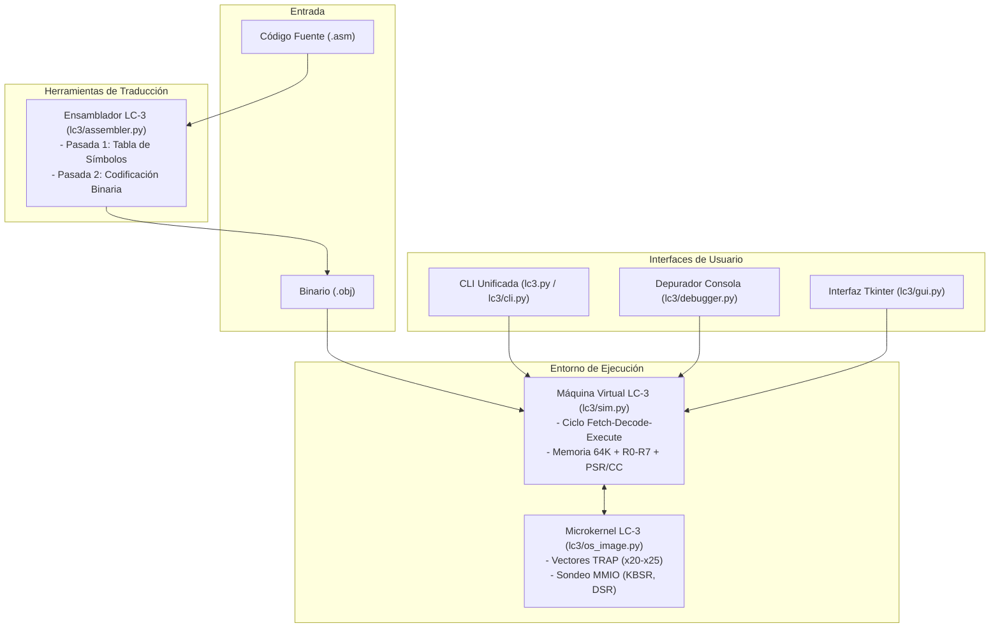

# Simulador y Ensamblador de la ISA LC-3 (Little Computer 3)

Este proyecto proporciona un entorno completo, pedagógico y funcional para la arquitectura **LC-3** desarrollado en **Python puro** (compatible con Python 3.8+ y probado en Python 3.14+). Incluye:

1. **Interfaz Gráfica de Usuario (GUI)** (`lc3/gui.py`): entorno de escritorio completo con editor integrado, desensamblador en vivo, seguimiento de PC, puntos de interrupción interactivos, visor/editor de memoria y registros, consola de E/S y control de velocidad.
2. **Sistema Operativo LC-3 en Memoria** (`lc3/os_image.py`): tabla de vectores de interrupción (`x0020`–`x0025`) y manejadores TRAP en lenguaje ensamblador que emulan fielmente el comportamiento de sondeo (polling) sobre registros MMIO (`KBSR`, `KBDR`, `DSR`, `DDR`, `MCR`).
3. **Ensamblador de dos pasadas** (`lc3/assembler.py`): traduce código fuente `.asm` a binarios `.obj` en formato estándar big-endian y genera tablas de símbolos `.sym` y volcados `.hex`.
4. **Simulador y Máquina Virtual** (`lc3/sim.py`): emula fielmente la arquitectura con ciclo fetch-decode-execute, memoria de 64K palabras, registros R0–R7, códigos de condición (N, Z, P), servicios de interrupción TRAP mediante hardware linkage y registros de E/S mapeados en memoria (MMIO).
5. **Depurador interactivo de consola** (`lc3/debugger.py`): permite depuración paso a paso (`step`, `next`), puntos de interrupción por dirección o nombre de etiqueta, desensamblado dinámico e inspección y edición de memoria y registros.
6. **CLI Unificada** (`lc3.py` / `lc3/cli.py`): interfaz de comandos sencilla y amigable (lanza la GUI por defecto o permite subcomandos `asm`, `run`, `debug`, `test`, `gui`).
7. **Programas de ejemplo** (`examples/`): programas listos para ensamblar y ejecutar.
8. **Suite de pruebas unitarias** (`tests/test_lc3.py`): 15 pruebas automáticas de la codificación, ejecución de instrucciones y rutinas del Sistema Operativo.

---

## Arquitectura del Sistema



---

## Estructura de Archivos

```
LC-3-FIO/
├── lc3.py              # CLI principal y lanzador raíz (gui, asm, run, debug, test)
├── lc3/                # Paquete modular del núcleo LC-3
│   ├── __init__.py     # Exportaciones de API pública del paquete
│   ├── core.py         # Definición de la ISA (registros, flags, opcodes, desensamblador)
│   ├── os_image.py     # Imagen y código ensamblador del Sistema Operativo LC-3 (Vectores TRAP y MMIO)
│   ├── assembler.py    # Ensamblador de dos pasadas y generador de .obj / .sym / .hex
│   ├── sim.py          # Simulador / Máquina Virtual (CPU, ciclo de instrucción, TRAPs, MMIO)
│   ├── debugger.py     # Depurador interactivo en consola estilo GDB
│   ├── gui.py          # Interfaz gráfica de escritorio moderna con Tkinter
│   └── cli.py          # Lógica interna de la interfaz de línea de comandos
├── tests/              # Suite de pruebas unitarias e integración
│   ├── __init__.py
│   └── test_lc3.py     # 15 pruebas unitarias automatizadas
├── examples/           # Programas de prueba en ensamblador LC-3
│   ├── hello.asm       # Imprime "Hello, World!" con PUTS
│   ├── mult.asm        # Multiplicación de 6 * 7 por sumas sucesivas
│   ├── count.asm       # Bucle contador regresivo (de 9 a 0)
│   └── echo.asm        # Eco interactivo de teclado con salida al pulsar 'q'
└── README.md           # Esta guía de uso y documentación técnica
```

---

## Resumen de la ISA LC-3

- **Palabra de datos / dirección**: 16 bits.
- **Espacio de memoria**: 65,536 direcciones ($2^{16}$ palabras de 16 bits), direccionadas por palabra.
- **Registros**:
  - `R0` a `R7`: 8 registros de propósito general (16 bits cada uno).
    - `R7`: Guardado automático de dirección de retorno en `JSR`, `JSRR` y `TRAP`.
  - `PC`: Contador de programa (16 bits, por convención inicia en `x3000`).
  - `CC`: Códigos de condición (N: negativo, Z: cero, P: positivo). Exactamente uno de ellos está activo tras escribir en un registro general.
- **Instrucciones soportadas**:
  - **Aritméticas y lógicas**: `ADD`, `AND`, `NOT`
  - **Bifurcaciones y saltos**: `BR` (`BRn`, `BRz`, `BRp`, `BRnz`, `BRnp`, `BRzp`, `BRnzp`), `JMP`, `RET`, `JSR`, `JSRR`
  - **Acceso a memoria**: `LD` (relativo a PC), `LDI` (indirecto), `LDR` (base + desplazamiento), `LEA` (cargar dirección efectiva), `ST` (almacenar relativo a PC), `STI` (indirecto), `STR` (base + desplazamiento)
  - **Sistema y llamadas TRAP**:
    - `GETC` (`TRAP x20`): Lee un carácter del teclado sin eco.
    - `OUT`  (`TRAP x21`): Imprime el carácter en R0.
    - `PUTS` (`TRAP x22`): Imprime una cadena terminada en nulo apuntada por R0.
    - `IN`   (`TRAP x23`): Solicita un carácter con mensaje y eco.
    - `PUTSP`(`TRAP x24`): Imprime cadena empaquetada (2 caracteres por palabra).
    - `HALT` (`TRAP x25`): Detiene el procesador.
- **E/S Mapeada en Memoria (MMIO)**:
  - `KBSR` (`0xFE00`): Registro de estado del teclado. Bit 15 es 1 cuando hay una nueva tecla lista; 0 en caso contrario.
  - `KBDR` (`0xFE02`): Registro de datos del teclado. Contiene el código ASCII de la tecla y limpia el bit 15 de `KBSR` al leerse.
  - `DSR` (`0xFE04`): Registro de estado de la pantalla. Bit 15 es 1 cuando la pantalla está lista para recibir un nuevo carácter.
  - `DDR` (`0xFE06`): Registro de datos de la pantalla. Al escribir un código ASCII aquí, se muestra en la consola.
  - `MCR` (`0xFFFE`): Registro de control de la máquina. Bit 15 habilita el reloj del procesador; ponerlo en 0 detiene la simulación (`HALT`).

---

## Sistema Operativo LC-3 y Emulación de Sondeo (Polling)

A diferencia de emuladores que interceptan las llamadas TRAP directamente en código de alto nivel, este simulador implementa el **Sistema Operativo auténtico de la LC-3** cargado en la memoria de la máquina virtual (`lc3/os_image.py`):

1. **Tabla de Vectores TRAP (`x0020` – `x0025`)**:
   - `x0020` (GETC)  $\rightarrow$ apunta al manejador en `x0200`
   - `x0021` (OUT)   $\rightarrow$ apunta al manejador en `x0206`
   - `x0022` (PUTS)  $\rightarrow$ apunta al manejador en `x020F`
   - `x0023` (IN)    $\rightarrow$ apunta al manejador en `x0223`
   - `x0024` (PUTSP) $\rightarrow$ apunta al manejador en `x0246`
   - `x0025` (HALT)  $\rightarrow$ apunta al manejador en `x0273`

2. **Mecanismo de Linkage por Hardware**:
   - Al ejecutarse la instrucción `TRAP trapvect8`, la CPU almacena la dirección de retorno en `R7` (`R7 = PC`) y carga en el contador de programa la dirección del manejador leída desde la tabla de vectores: `PC = mem[trapvect8]`.

3. **Bucles de Sondeo en Ensamblador (Polling)**:
   - Los manejadores del SO ejecutan bucles reales de sondeo sobre los registros de dispositivo:
     ```assembly
     ; Bucle de sondeo del teclado en GETC
     GETC_POLL:
         LDI  R0, OS_KBSR_PTR   ; Lee KBSR (xFE00)
         BRzp GETC_POLL         ; Si bit 15 es 0 (no hay tecla), sigue sondeando
         LDI  R0, OS_KBDR_PTR   ; Lee el carácter desde KBDR (xFE02)
         RET                    ; Retorna al programa de usuario con JMP R7
     ```
   - Al ejecutar `OUT`, el SO sondea `DSR` (`xFE04`) hasta que la pantalla esté lista antes de escribir en `DDR` (`xFE06`).
   - Al ejecutar `HALT`, el manejador imprime el aviso de parada con `PUTS`, lee `MCR` (`xFFFE`), limpia el bit 15 y escribe el nuevo valor (`x7FFF`), deteniendo el reloj de la CPU.

4. **Depuración Pedagógica (Paso a Paso vs Paso Sobre)**:
   - **Paso a Paso (`Step` / `F11`)**: permite ingresar a los manejadores del SO en `x0200` y observar instrucción a instrucción el sondeo de `KBSR`, la lectura de `KBDR` y el retorno con `RET`.
   - **Paso Sobre (`Step Over` / `F12`)**: ejecuta el TRAP completo hasta la instrucción siguiente en el espacio de usuario, facilitando la depuración de alto nivel sin perder interactividad.
   - **Integración fluida con la GUI**: durante el sondeo del teclado, la GUI detecta la espera de entrada en `KBSR`, ilumina la caja de texto en amarillo, enfoca el cursor y muestra el estado `"ESPERANDO ENTRADA"` sin bloquear la interfaz.

---

## Requisitos Previos

- **Python**: Versión 3.8 o superior (probado en Python 3.10 a 3.14).
- **Soporte de GUI (Tkinter)**:
  - En Windows y macOS se incluye de forma nativa con el instalador de Python.
  - En distribuciones Linux (si no está instalado):
    - Debian / Ubuntu: `sudo apt install python3-tk`
    - Arch Linux: `sudo pacman -S tk`
    - Fedora: `sudo dnf install python3-tkinter`

---

## Guía de Uso Rápida

### 1. Iniciar la Interfaz Gráfica (GUI)

La forma más visual e interactiva de usar el simulador es a través de su interfaz gráfica de escritorio:

```bash
python lc3.py
```
*(O también: `python lc3.py gui` o `python lc3.py gui examples/mult.asm`).*

#### Características Principales de la GUI:
- **Barra de control**: Botones para `Ejecutar (Run)`, `Pausar (Pause)`, `Paso a Paso (Step)`, `Paso Sobre Subrutinas (Step Over)` y `Reiniciar (Reset)`.
- **Control de velocidad**: Deslizador para variar la velocidad de simulación entre 1 ms y 200 ms por instrucción (o máxima velocidad).
- **Desensamblado en vivo**:
  - Muestra la dirección, código hexadecimal, instrucción decodificada y etiquetas simbólicas.
  - La fila con el **PC activo** se resalta en verde y se auto-desplaza al ejecutar.
  - **Puntos de interrupción (Breakpoints)**: haz doble clic en cualquier fila o en la columna `BP` para activar o desactivar un punto de interrupción (marcado con `●`).
- **Registros y Flags**:
  - Muestra R0–R7 en formato hexadecimal, decimal con signo y sin signo.
  - Haz doble clic sobre cualquier registro para modificar su valor en tiempo real.
  - Indicadores visuales de Condition Codes: **[ N ]**, **[ Z ]**, **[ P ]** (se iluminan en colores activos).
- **Explorador de Memoria**:
  - Visualiza cualquier región de la memoria con valores hexadecimales, enteros y caracteres ASCII.
  - Haz doble clic sobre una celda para editarla directamente.
- **Consola de Entrada / Salida (Terminal)**:
  - Muestra salidas generadas por `OUT`, `PUTS`, `PUTSP` y escrituras a `DDR` (MMIO).
  - Permite ingresar datos de teclado interactivos para `IN`, `GETC` o `KBDR`.
- **Editor de Código Assembly Integrado**:
  - Pestaña para escribir o editar código `.asm` directamente.
  - Botón **"Ensamblar y Cargar al Simulador"** que compila el código en memoria y lo ejecuta inmediatamente.

---

### 2. Ensamblar un archivo `.asm` desde la consola

Traduce el código fuente a un archivo binario ejecutable `.obj`:

```bash
python lc3.py asm examples/hello.asm
```

Opciones útiles:
- `-o ruta.obj`: Especifica el nombre del archivo de salida.
- `--hex`: Genera además un archivo de texto `.hex` con el volcado hexadecimal de memoria para inspección o Logisim.

Ejemplo:
```bash
python lc3.py asm examples/mult.asm --hex
```

### 3. Ejecutar un programa en la Máquina Virtual

Ejecuta el programa directamente hasta que alcance una instrucción `HALT`:

```bash
python lc3.py run examples/hello.obj
```

> **Nota**: Si pasas un archivo `.asm` directamente a `run`, el CLI lo ensamblará automáticamente antes de ejecutarlo:
> ```bash
> python lc3.py run examples/hello.asm
> ```

Opciones adicionales:
- `--stats`: Muestra estadísticas finales (número total de instrucciones ejecutadas, valores de registros y PC final).
- `--max-steps N`: Limita la ejecución a un número máximo de ciclos de instrucción (útil para detectar bucles infinitos).

### 4. Depurar interactivamente desde la consola

Inicia la sesión interactiva de depuración:

```bash
python lc3.py debug examples/mult.obj
```

La consola de depuración cargará automáticamente la tabla de símbolos `.sym` asociada, permitiéndote utilizar nombres de etiquetas directamente.

#### Comandos del Depurador:

| Comando | Alias | Descripción | Ejemplo |
| :--- | :--- | :--- | :--- |
| `step` | `s` | Ejecuta una sola instrucción (entra a subrutinas) | `s` |
| `next` | `n` | Ejecuta la siguiente instrucción saltando subrutinas/TRAPs (Step Over) | `n` |
| `continue` | `c` | Continúa la ejecución normal hasta un breakpoint o HALT | `c` |
| `break <addr\|label>` | `b` | Establece un punto de interrupción en una dirección o etiqueta | `b DONE` o `b x3005` |
| `delete <addr\|label>` | `del` | Elimina un punto de interrupción existente | `del DONE` |
| `info b` | | Lista todos los puntos de interrupción activos | `info b` |
| `registers` | `r` | Muestra los registros R0–R7 (en hex y dec), PC, CC y siguiente instrucción | `r` |
| `memory <addr> [n]` | `m` | Vuelca `n` palabras de memoria con valores hex, dec y caracteres ASCII | `m x3000 8` |
| `disasm [addr] [n]` | `d` | Desensambla `n` instrucciones a partir de una dirección o PC | `d x3000 10` |
| `set r<0-7> <val>` | | Modifica el valor de un registro de la CPU | `set r1 #42` o `set r2 xFF` |
| `set mem <addr> <val>`| | Modifica el contenido de una celda de memoria | `set mem x300C #10` |
| `set pc <addr>` | | Modifica manualmente el contador de programa | `set pc x3000` |
| `reset` | | Reinicia los registros y el PC a la dirección de origen (.ORIG) | `reset` |
| `help` | `h` | Muestra el menú de ayuda con todos los comandos | `h` |
| `quit` | `q` | Sale de la sesión de depuración | `q` |
| `[Enter]` | | Al presionar Enter sin escribir texto, repite el último comando ejecutado | |

---

## Suite de Pruebas Automatizadas

El proyecto incluye 15 pruebas unitarias e integrales que verifican:
- Codificación y extensión de signo de inmediatos.
- Formatos de instrucciones y validación de rangos de saltos.
- Detección de errores sintácticos y etiquetas no definidas.
- Operaciones aritméticas, lógicas y actualización de códigos de condición (N, Z, P).
- Saltos condicionales y subrutinas (`JSR` / `RET`).
- Ejecución completa de programas de ejemplo verificando cálculos y salidas por pantalla.

Para ejecutar todas las pruebas:

```bash
python lc3.py test
```
o bien:
```bash
python -m unittest discover tests
python tests/test_lc3.py
```

---

## Formato del Código Ensamblador (.asm)

- **Comentarios**: Inician con punto y coma `;` hasta el final de la línea.
- **Números**:
  - Decimales: `#10`, `#-5`, `10`
  - Hexadecimales: `x3000`, `0x3000`, `xFF`
  - Binarios: `b1010`, `0b1010`
- **Etiquetas**: Al comienzo de la línea (opcionalmente seguidas de dos puntos `:`). Pueden estar solas o en la misma línea que una instrucción.
- **Directivas**:
  - `.ORIG <addr>`: Fija la dirección inicial en memoria (obligatoria al inicio).
  - `.FILL <val|label>`: Reserva una palabra con el valor o dirección de la etiqueta dada.
  - `.BLKW <count>`: Reserva un bloque contiguo de `<count>` palabras (inicializadas en cero).
  - `.STRINGZ "<texto>"`: Almacena una cadena de caracteres ASCII terminada con el carácter nulo (`\0`).
  - `.END`: Indica el fin del archivo fuente.

---

## Convenciones de Contribución

El proyecto utiliza el estándar de **Conventional Commits**:
- `feat`: Incorporación de una nueva funcionalidad.
- `fix`: Corrección de un defecto o bug.
- `refactor`: Modificaciones de código que no corrigen bugs ni agregan funcionalidades.
- `docs`: Cambios exclusivos en archivos de documentación.
- `test`: Adición o actualización de pruebas unitarias o de integración.
